# project-smart-picking-arm-2

[English](README.md) | [繁體中文](README-zh.md) | **日本語**

## 目的

手首に深度カメラを付けたロボットアームが、3 種類の配管継手がランダムに積まれたカゴを見て、次に取る部品と掴み方を自分で決めます。部品は種類ごとに赤・青・黄の箱へ仕分けられ、カゴが空になるまで続きます。すべて NVIDIA Isaac Sim 上で動作します。

<p align="center">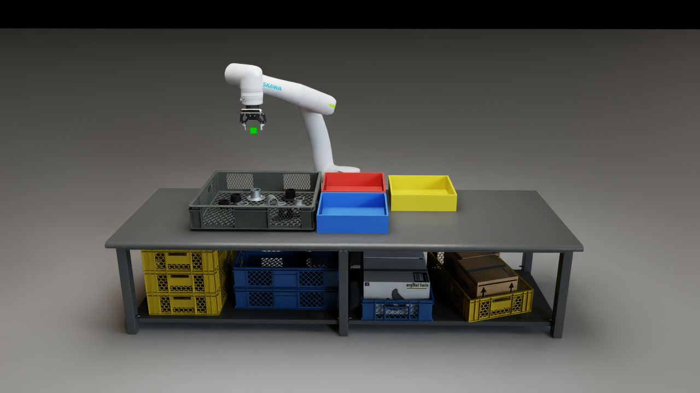</p>

## 環境

### 機器と部品

| 項目 | 内容 |
|---|---|
| アーム | 安川電機 Motoman NEXT NHC12（6 軸） |
| グリッパ | Robotiq 2F-85（最大開き 85 mm） |
| カメラ | 手首の Intel RealSense D455。左カメラの画像（640 × 480）と深度を使用 |
| 部品 | 配管継手 3 種類。それぞれ黒と亜鉛めっきの 2 種類の表面。1 カゴ 8 個 |
| 箱 | `flange_round` → 赤、`bracket_mid` → 青、`bracket_end` → 黄 |

`flange_round` と `bracket_end` は、ベースプレートの上に外径 60 mm の円管が立った形です。`bracket_mid` は平置きで、中央に円管があります。アームが使う情報は手首の D455 から得られるものだけです。

### ソフトウェア

| 項目 | 内容 |
|---|---|
| シミュレータ | NVIDIA Isaac Sim 6.0（シーン `scenes/lab_cell_g1.usda`） |
| 物体認識 | YOLO26n-seg インスタンスセグメンテーション（Ultralytics）、3 クラス、入力 960 |
| YOLO の実行環境 | 独立した Python 3.12 環境（`perception/.venv`）で、バックグラウンドのサーバとして動作 |

## 結果

1 カゴ分の仕分け（3 倍速）：メインは作業セルの正面、右上は手首 D455 の映像です。フル動画：[`outputs/demo/sort_demo.mp4`](outputs/demo/sort_demo.mp4)。

<p align="center">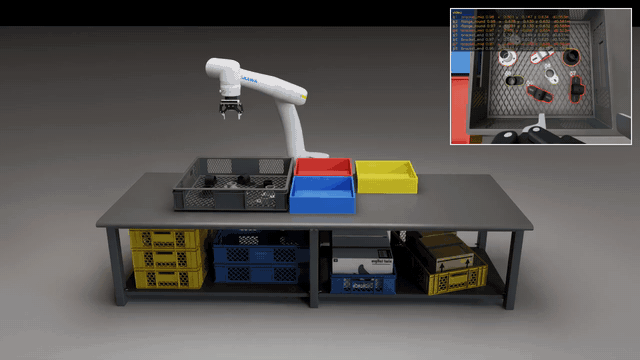</p>

## 仕組み

### 1. 認識：YOLO

学習データはすべてシミュレーションで作りました。部品を物理演算でカゴに落として山積みにし、シミュレーション上の D455 がランダムな経路に沿って撮影します。

<p align="center">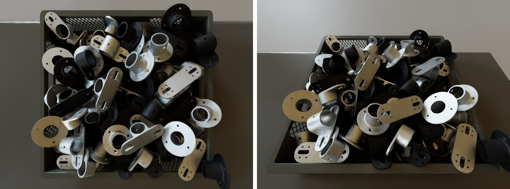</p>

撮影ごとに、カゴ、テーブル、床、照明、部品の表面を変えています。

<p align="center">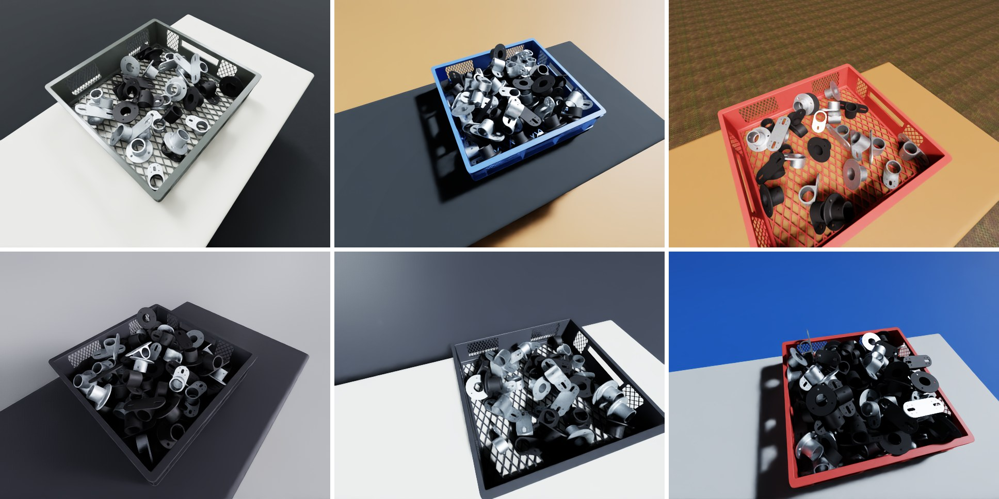</p>

カメラの高さ・傾き・向きは一定の範囲に分布させ、照明は明るい・普通・暗いの 3 段階に分けています。

<p align="center">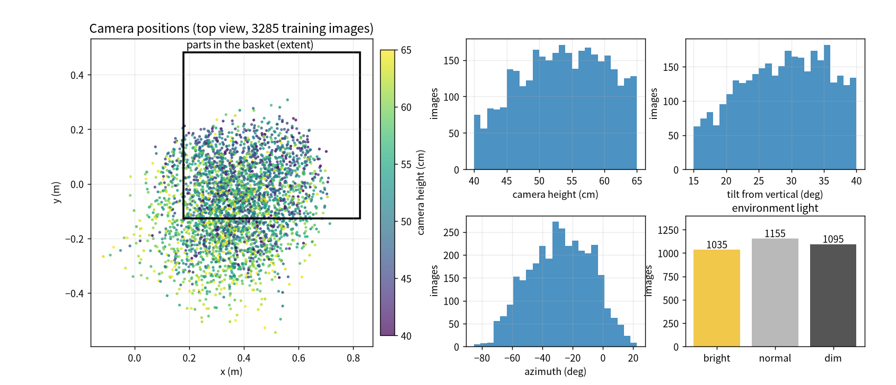</p>

シミュレータは部品ごとのマスクも同時に出力し、これをラベルとして使います。

<p align="center">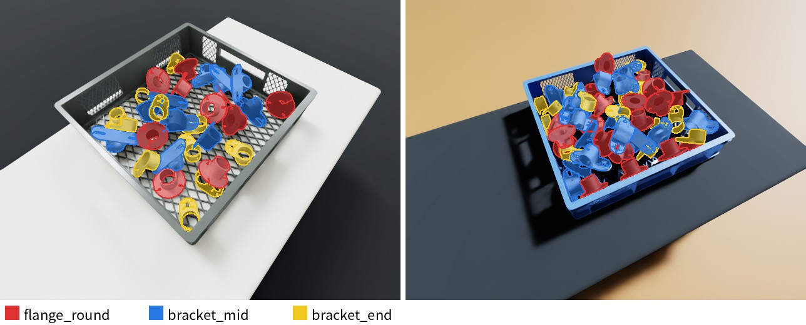</p>

| データ | 画像数 | 用途 |
|---|---|---|
| 学習 | 3285 枚 | モデルの学習 |
| 検証 | 450 枚（30 カゴ） | 設定の比較、モデルの選択 |
| テスト | 300 枚（20 カゴ） | 最終評価 |

検証とテストには学習で使っていない照明とテーブルを使い、初めて見る環境でも正しく認識できることを確かめています。モデルはまず平らなテーブル上の部品で学習し、その後 3285 枚の山積み画像で 100 エポック追加学習しました（入力 960）。

### 2. 点群から掴み方を決める

深度カメラは YOLO のマスクを世界座標の点群に変換します。アームはカゴの真上の高い位置（view A）で一度だけカゴ全体を見て、点群から各部品の掴み方と置き場所を決めます。

<p align="center">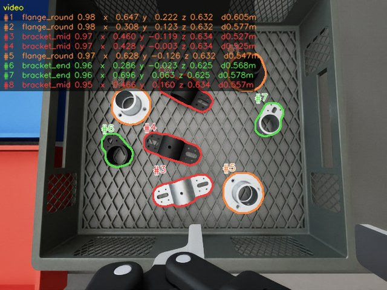</p>
<p align="center">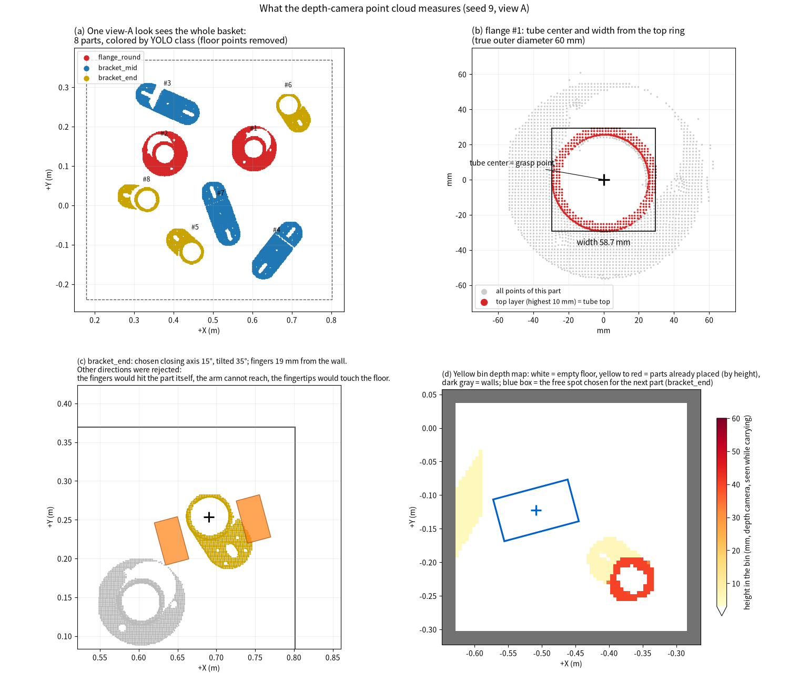</p>

(a)〜(d) はロボットが実際に処理する順番で、判断はすべてカメラの点から行います。

- **(a)** view A で一度見て、各部品の点とクラスを得ます。
- **(b)** 掴む部品について、いちばん上の点の輪から円管を見つけます。円管の中心が把持点に、幅がグリッパの開き量になります。
- **(c)** 閉じる方向を一つずつ試し、両指が部品自身・隣の部品・カゴの壁・底に当たらず、アームが届く方向だけを残します。必要ならグリッパを傾けます。
- **(d)** 運んでいる間に同じカメラで目的の箱を見て、部品と開いた指が収まる空きスペースを選びます。

### 3. 取る順番

順番は view A で一度に決めます。種類に関係なく、アームの根元に近い部品から並べます。まだ掴めない部品は列の最後に回し、順番が来たときに計画し直します。その後アームは一つずつ掴んで対応する箱に置き、そのまま次の部品へ向かいます。view A に戻って見直すのは、掴みに失敗したとき、持ち上げ中に部品が滑ったとき、次の部品が直前の動作で動いたかもしれないときだけです。

### 4. 3 種類の部品の掴み方

3 種類とも円管の部分を掴みます。`flange_round` と `bracket_end` は立った円管を、`bracket_mid` はできるだけ円管を両側から掴みます。候補の方向はそれぞれ、指が隣の部品・カゴの壁・底に当たらないことを確認し、その中で傾きが最も小さいものを選びます。下の図は、各部品を実際に掴んだときの上面と 2 つの側面です。

<p align="center">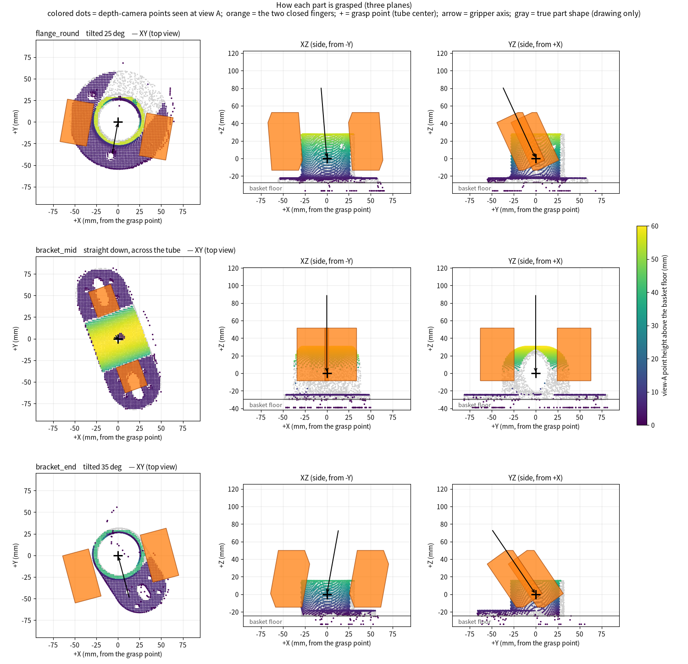</p>

### 5. アームの動き

アームは逆運動学で目標点に追従し、目標点は角を丸めた滑らかな経路に沿って動きます。カゴのほとんどの場所ではグリッパは真下を向いたままです。部品が遠く、奥の角に近いほど、システムは自動的にグリッパを傾け（最大約 40°）、届かせつつ十分な搬送高さまで持ち上げます。

<p align="center">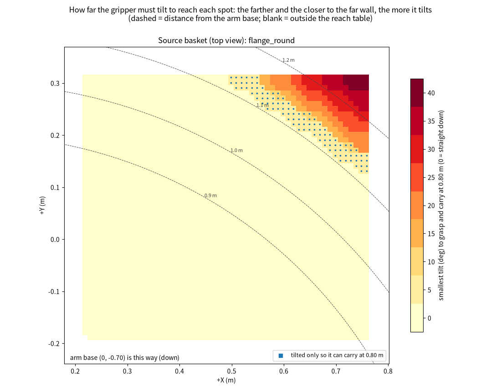</p>

持ち上げと置く動作はゆっくり行います。その間の移動は台形速度プロファイル（加速度 1.2 m/s²、最高 1.0 m/s）で、距離が短いときは最高速度に達する前に減速を始めます。

<p align="center">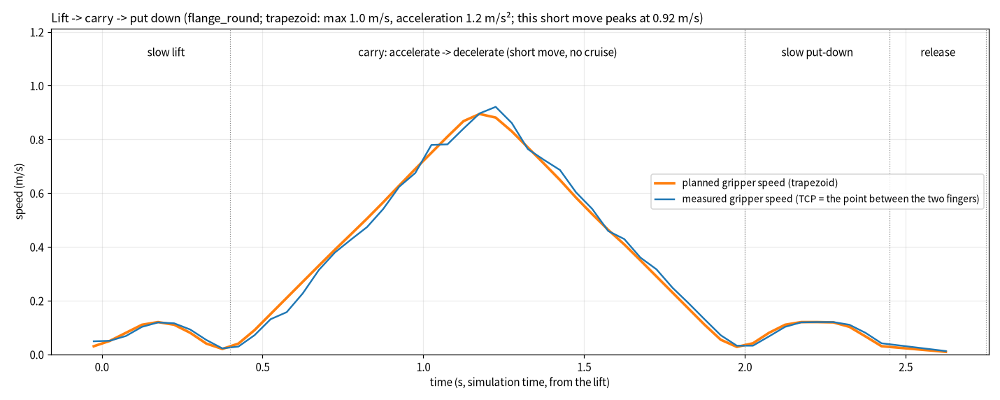</p>

## 使い方

**初回のみ**

1. YOLO 用の Python 環境を作ります（事前に `uv` が必要です）。

   ```bash
   LOCK=requirements.basket.lock.txt bash perception/setup_yolo_env.sh
   ```

2. シーンの照明ファイルは `/mnt/data/Lin(sda)/About Yolo/assets/` から読み込まれます。このディスクがマウントされていることを確認してください。

**手順**

1. Isaac Sim で `scenes/lab_cell_g1.usda` を開きます。
2. Script Editor に次の 1 行を貼り付け、パスをこのフォルダに書き換えて実行します。約 10 秒で `demo_start: READY` と表示されます。

   ```python
   exec(open("/path/to/project-smart-picking-arm-2/demo_start.py").read())
   ```

3. 部品を並べます。数字は配置番号で、同じ番号なら毎回同じ配置になります。

   ```python
   layout(26, 8)
   ```

4. 仕分けを始めます。コマンドはすぐに戻り、アームはバックグラウンドで動きます。カゴが空になるとコンソールに結果が表示されます。次の `layout()` はそれまで待ってください。

   ```python
   sort()
   ```

| コマンド | 入力 | 出力 |
|---|---|---|
| `layout(seed, count=8)` | 配置番号、部品数 | カゴに部品を配置し、3 つの箱を空にする |
| `sort()` | なし | 部品を種類ごとの箱へ仕分け。結果をコンソールに表示し、`outputs/sort/<時刻>_s<seed>_n<部品数>/` に記録 |

配置は実行中のセッションにだけ存在します。シーンは保存しないでください。

## 流れ

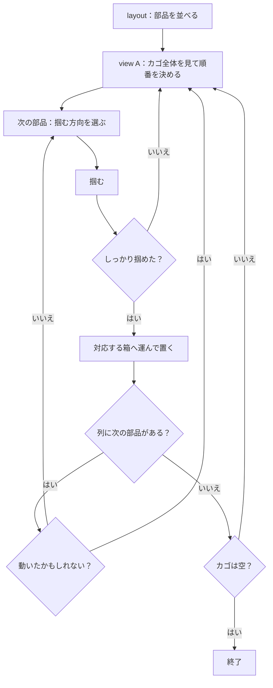

## 性能（シミュレーション）

**認識**：テストデータで、あるクラスを指定したとき、信頼度が最も高い検出が正しい部品で、かつマスクが実際の輪郭と 75% 以上重なる割合は、`flange_round` 100%、`bracket_mid` 99.9%、`bracket_end` 100% です。

<p align="center">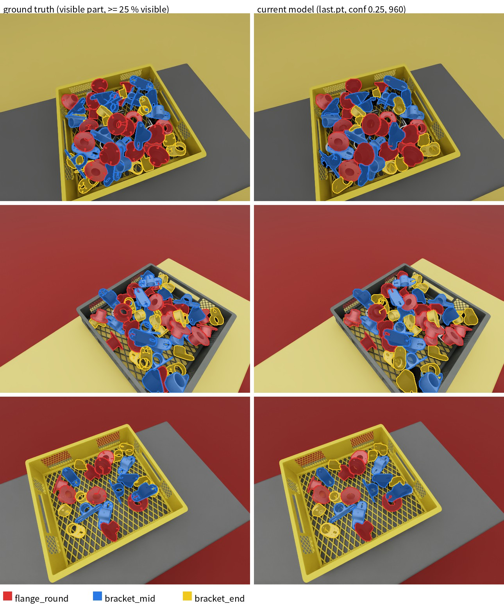</p>

**仕分け**：ランダムな 11 通りの配置（壁際や角の部品を含む）で、88 個すべてが正しい箱に入りました。1 個あたり約 9.5 秒です。

## 起こりうる失敗と対策

| 状況 | 対策 |
|---|---|
| 持ち上げ中に部品が滑る | 一度戻して少し強く掴み直す。それでも滑るときは放して view A で見直す |
| 掴みに失敗する | view A で見直す。同じ場所で 2 回失敗した部品は飛ばす |
| 1 個の部品が 2 個に見える | 空振りしたあと view A で見直す |
| 部品が壁際や角にある | グリッパを傾けて差し込み、持ち上げと搬送の間もその角度を保つ |
| 2 個同時に掴む | 掴んだ幅を確認し、広すぎて隣に部品があれば放してやり直す |
| 動作で次の部品が動く | view A で見直す |

## フォルダ構成

| パス | 内容 |
|---|---|
| `demo_start.py` | 起動スクリプト |
| `lab/` | 認識と追跡、把持計画、アームの動作、`layout()` と `sort()` |
| `perception/` | カメラと YOLO サーバ、認識の設定 |
| `scripts/ik_controller.py` | アームの逆運動学コントローラ |
| `scenes/`、`assets/`、`parts/usd/` | シーンとアセット |
| `yolo/` | モデルと学習の記録 |
| `outputs/demo/` | このページの画像と動画 |
