# project-smart-picking-arm-2

[English](README.md) | **繁體中文** | [日本語](README-ja.md)

## 目的

一支腕上裝有深度相機的機械手臂，面對一籃隨機混放的三種管件接頭，自己決定夾取順序與方向，依種類把零件放進紅、藍、黃三個箱子，直到籃子清空。整個系統在 NVIDIA Isaac Sim 中運作。

<p align="center">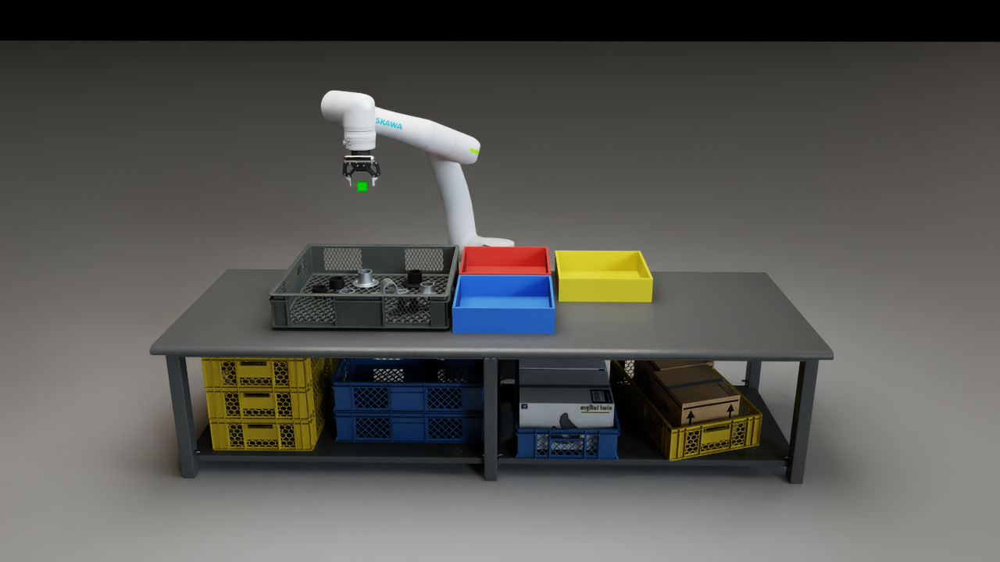</p>

## 環境

### 設備與零件

| 項目 | 內容 |
|---|---|
| 手臂 | Yaskawa Motoman NEXT NHC12（6 軸） |
| 夾爪 | Robotiq 2F-85（最大開口 85 mm） |
| 相機 | 手腕上的 Intel RealSense D455，使用左眼影像（640 × 480）與深度 |
| 零件 | 三種管件接頭，各有黑色與鍍鋅兩種表面；每籃 8 件 |
| 箱子 | `flange_round`（圓法蘭）→ 紅箱；`bracket_mid`（中間支架）→ 藍箱；`bracket_end`（端部支架）→ 黃箱 |

`flange_round` 與 `bracket_end` 是直立的圓管（外徑 60 mm）加上底座；`bracket_mid` 是平躺的支架，中間有一段圓管。手臂只靠腕上 D455 看到的影像與深度工作。

### 軟體

| 項目 | 內容 |
|---|---|
| 模擬器 | NVIDIA Isaac Sim 6.0（場景 `scenes/lab_cell_g1.usda`） |
| 物件辨識 | YOLO26n-seg 實例分割（Ultralytics），三個類別，輸入 960 |
| YOLO 執行環境 | 獨立的 Python 3.12 環境（`perception/.venv`），以伺服器形式在背景執行 |

## 結果

分完一整籃（3 倍速）：主畫面是工作台正面，右上角是手腕 D455 的畫面。完整影片：[`outputs/demo/sort_demo.mp4`](outputs/demo/sort_demo.mp4)。

<p align="center">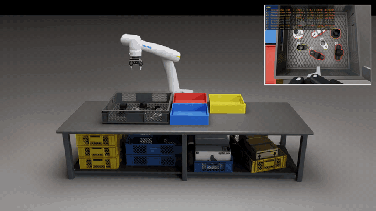</p>

## 理論

### 1. 辨識：YOLO

訓練資料全部來自模擬：零件以物理方式倒入籃中堆疊，模擬的 D455 沿隨機路徑拍攝。

<p align="center">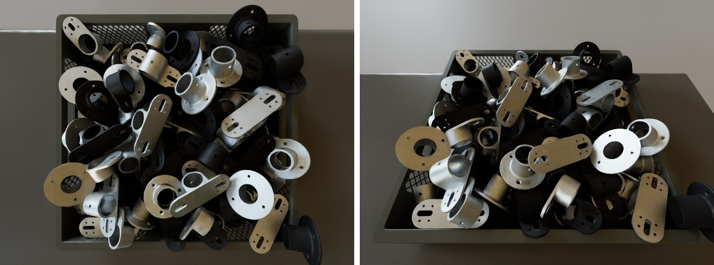</p>

每一段拍攝都更換籃子、桌面、地板、環境光與零件表面（黑色或鍍鋅）。

<p align="center">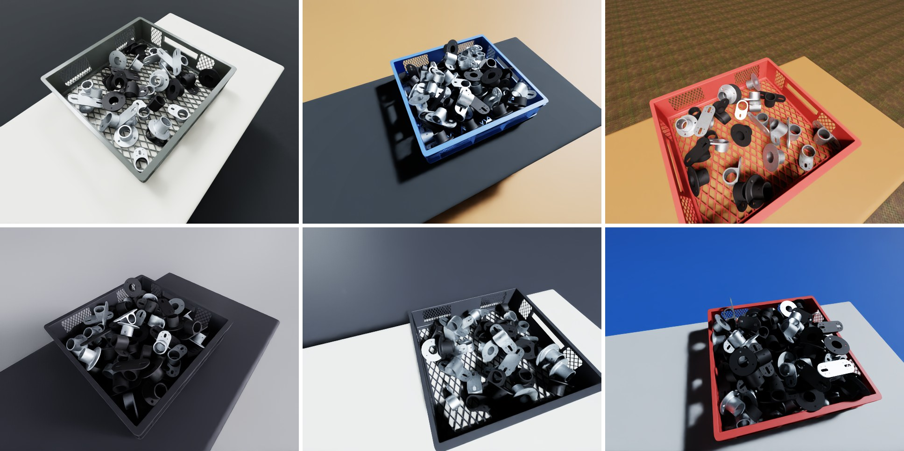</p>

相機的高度、俯角與方位在一定範圍內隨機分布，環境光分成明亮、一般、較暗三種。

<p align="center">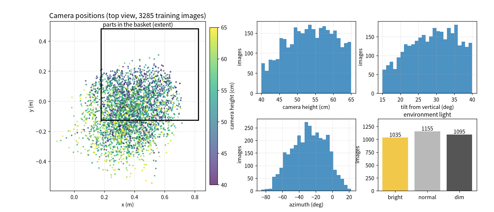</p>

模擬器同時輸出每一件零件的遮罩，作為標註。

<p align="center">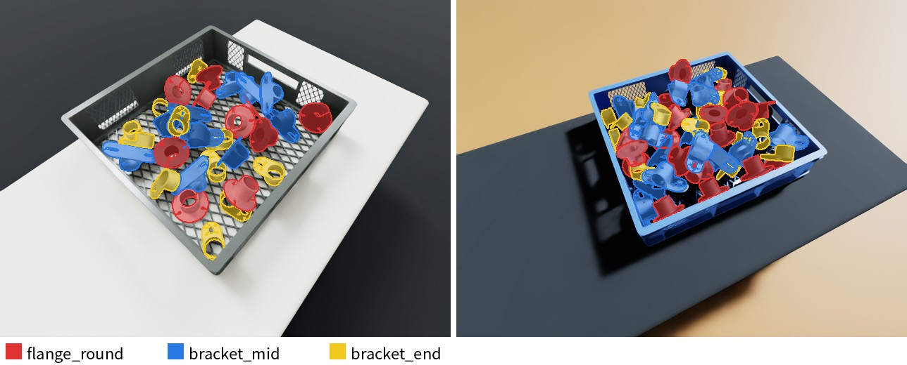</p>

| 資料組 | 影像數 | 用途 |
|---|---|---|
| 訓練 | 3285 張 | 學習 |
| 驗證 | 450 張（30 籃） | 比較設定、選模型 |
| 測試 | 300 張（20 籃） | 最終成績 |

驗證與測試組使用訓練時沒有出現過的環境光與桌面，確認模型在新環境下仍然準確。模型先以平桌面上的零件訓練，再用 3285 張堆疊影像接著訓練 100 輪（輸入 960）。

### 2. 從點雲決定怎麼夾

深度相機把 YOLO 的每個遮罩換算成世界座標中的點雲。手臂停在籃子正上方的高處（view A）看整籃，再從點雲決定怎麼夾、放在哪裡。

<p align="center">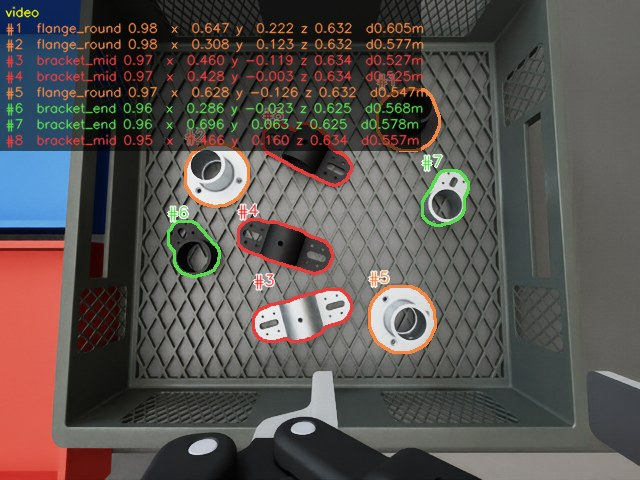</p>
<p align="center">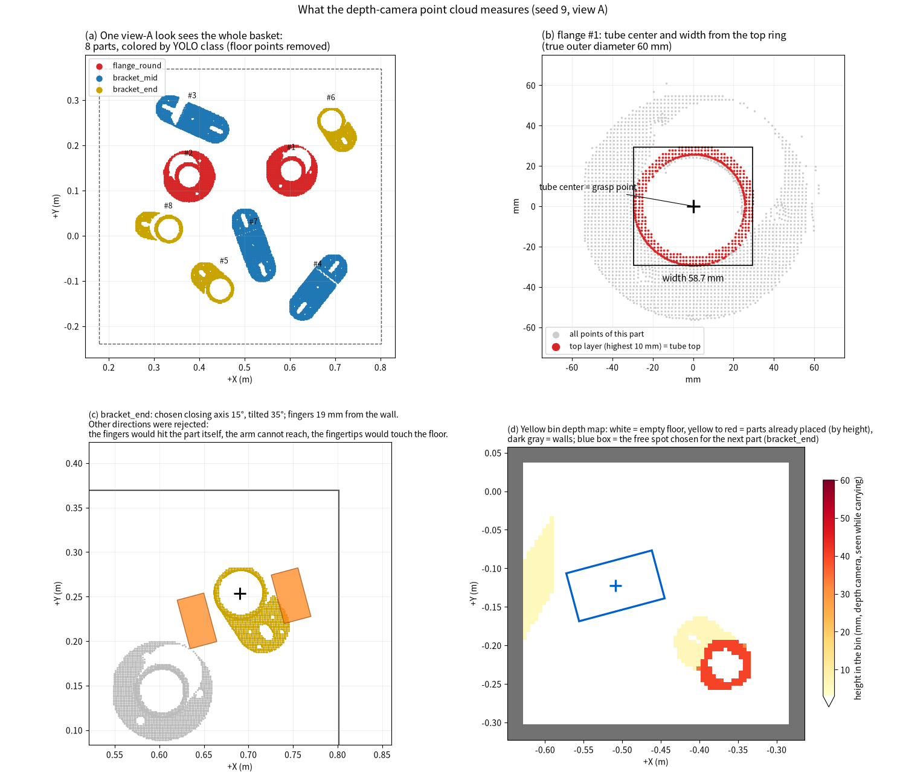</p>

圖中 (a) 到 (d) 是手臂實際的處理順序，所有判斷都來自深度相機的點：

- **(a)** 在 view A 看一次，取得每一件零件的點與類別。
- **(b)** 對要夾的零件，從最上層的一圈點找出圓管，得到夾取點（圓管中心）與夾爪要張開的寬度。
- **(c)** 逐一嘗試夾取方向，保留兩根手指都不會碰到零件本身、鄰件、籃牆與籃底，而且手臂到得了的方向；必要時讓夾爪傾斜。
- **(d)** 搬運途中，同一支相機看清目標箱子，選出一塊足以放下零件與張開手指的空位。

### 3. 夾取順序

在 view A 一次排好順序：不分類別，依離手臂基座的距離由近到遠。暫時夾不到的零件移到隊伍最後，輪到時再重新規劃。之後手臂一件接一件夾取、放入對應箱子，直接前往下一件；只有夾取失敗、提起時零件滑動，或下一件可能被剛才的動作碰動時，才回 view A 重新觀察。

### 4. 三種零件的夾法

三種零件都夾在圓管上。`flange_round` 與 `bracket_end` 夾直立圓管；`bracket_mid` 優先從圓管兩側夾。每個候選方向都要確認手指不碰鄰件、不碰籃牆、不碰籃底，再選傾斜最小的方向。下圖是三種零件實際夾取時的俯視與兩個側視。

<p align="center">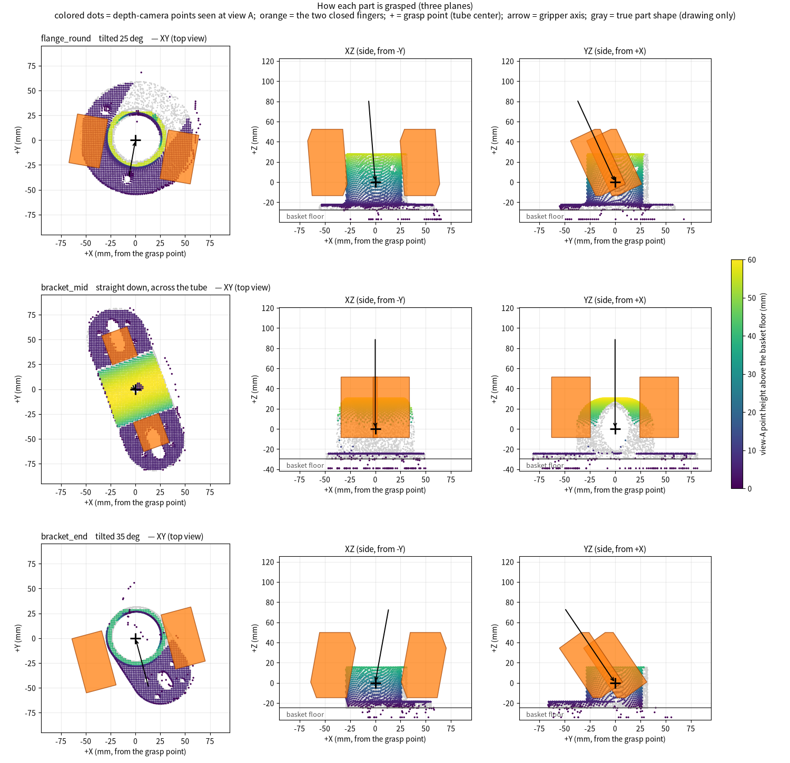</p>

### 5. 手臂的移動

手臂以逆向運動學追隨一個目標點，目標點沿著規劃好的連續路徑移動，轉角以圓弧連接。大部分位置夾爪都直直往下；零件越遠、越靠近遠側角落，系統就越會自動讓夾爪斜著伸入（最多約 40°），同時維持足夠的搬運高度。

<p align="center">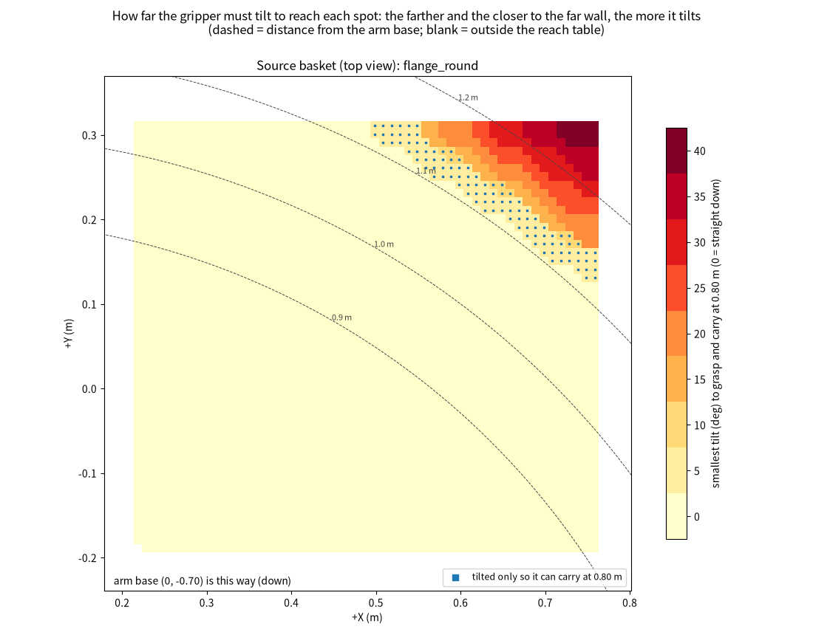</p>

抬起與放下都慢速進行；平移採用梯形速度（加速度 1.2 m/s²、最高 1.0 m/s），距離短時還沒到最高速就開始減速。

<p align="center">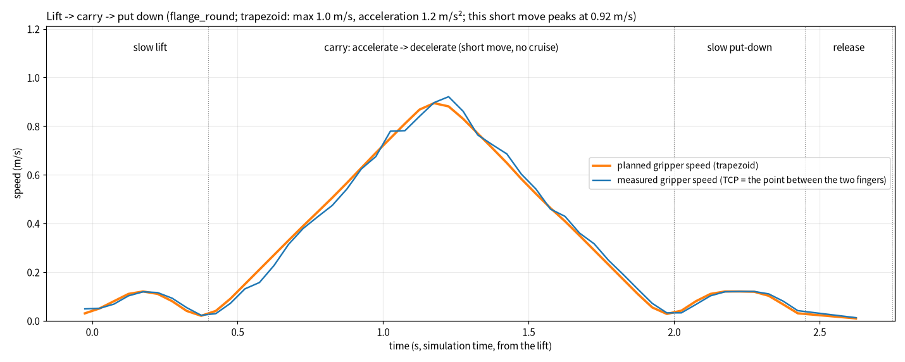</p>

## 操作方法

**事前準備（只需一次）**

1. 建立 YOLO 用的 Python 環境（需要先安裝 `uv`）：

   ```bash
   LOCK=requirements.basket.lock.txt bash perception/setup_yolo_env.sh
   ```

2. 場景的環境光檔案位於 `/mnt/data/Lin(sda)/About Yolo/assets/`，執行前請確認磁碟已掛載。

**步驟**

1. 在 Isaac Sim 開啟 `scenes/lab_cell_g1.usda`。
2. 在 Script Editor 貼上下面這一行並執行（把路徑換成本資料夾的位置），約 10 秒後出現 `demo_start: READY`：

   ```python
   exec(open("/path/to/project-smart-picking-arm-2/demo_start.py").read())
   ```

3. 擺放零件。數字是擺放編號，同一個編號每次擺法相同：

   ```python
   layout(26, 8)
   ```

4. 開始分料。指令會立刻返回，手臂在背景動作，分完整籃時主控台印出結果；下一次 `layout()` 請等這次結束再執行：

   ```python
   sort()
   ```

| 指令 | 輸入 | 輸出 |
|---|---|---|
| `layout(seed, count=8)` | 擺放編號、件數 | 籃中擺好零件，三個箱子清空 |
| `sort()` | 無 | 零件依類別放入箱子；主控台列出結果，紀錄寫入 `outputs/sort/<時間>_s<seed>_n<件數>/` |

擺放只存在於這次執行中，請不要存檔場景。

## 流程

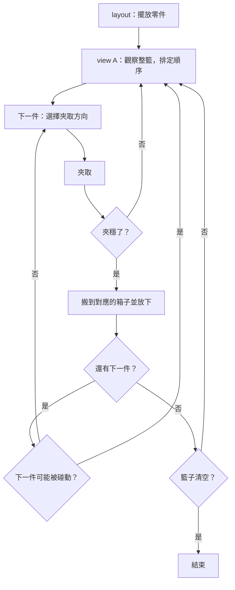

## 性能（模擬）

**辨識**：在測試組上，被要求某一類時，信心最高的那一件是正確零件、且遮罩與真實輪廓重疊 75% 以上的比例：`flange_round` 100%、`bracket_mid` 99.9%、`bracket_end` 100%。

<p align="center">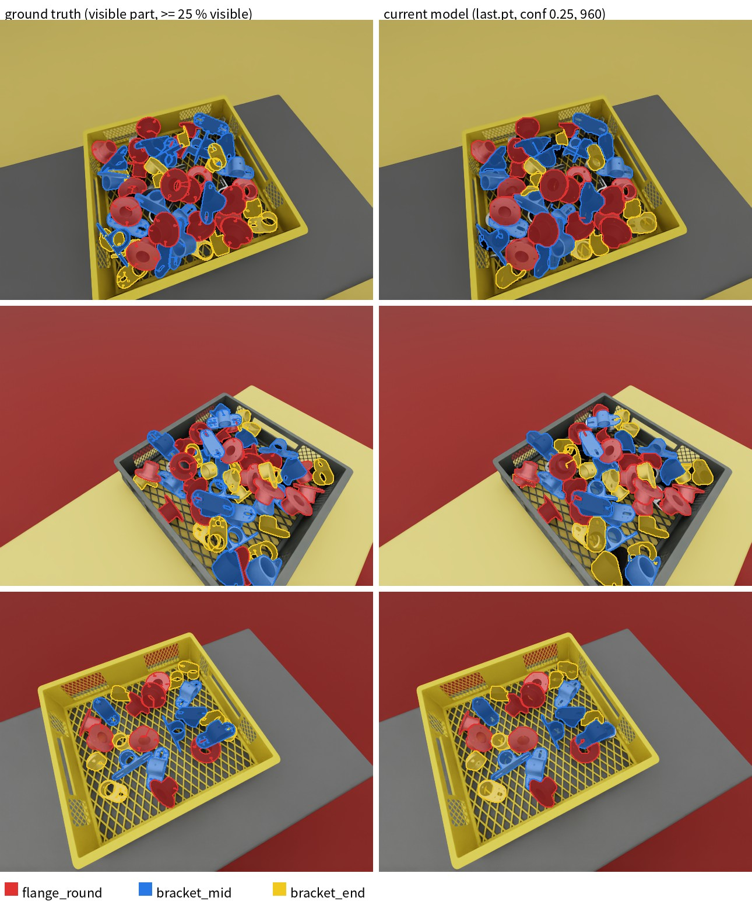</p>

**分料**：11 種隨機擺放（含零件貼牆、落在角落），共 88 件全部放入正確箱子；每件約 9.5 秒。

## 可能的失誤與對策

| 情況 | 對策 |
|---|---|
| 提起時滑動 | 放回去夾緊一點再試；仍然不穩就放開，回 view A 重新觀察 |
| 夾取失敗 | 回 view A 重新觀察；同一處失敗兩次就略過該件 |
| 同一件零件被辨識成兩件 | 撲空後回 view A 重新觀察 |
| 零件貼牆或在角落 | 夾爪傾斜伸入，抬起與搬運時維持同一角度 |
| 一次夾到兩件 | 比對夾住後的寬度，偏大且旁邊有零件就放開重來 |
| 動作碰動下一件 | 回 view A 重新觀察 |

## 資料夾

| 位置 | 內容 |
|---|---|
| `demo_start.py` | 啟動入口 |
| `lab/` | 辨識追蹤、夾取規劃、手臂動作、`layout()` 與 `sort()` |
| `perception/` | 相機與 YOLO 伺服器、辨識設定 |
| `scripts/ik_controller.py` | 手臂的逆向運動學控制器 |
| `scenes/`、`assets/`、`parts/usd/` | 場景與資產 |
| `yolo/` | 模型與訓練紀錄 |
| `outputs/demo/` | 本頁的圖片與影片 |
