# project-smart-picking-arm-2

**English** | [繁體中文](README-zh.md) | [日本語](README-ja.md)

## Purpose

A robot arm with a depth camera on its wrist looks at a basket of three kinds of pipe fittings, piled at random. It decides on its own which part to pick next and how to grip it, then places every part in a red, blue or yellow bin by type until the basket is empty. Everything runs in NVIDIA Isaac Sim.

<p align="center">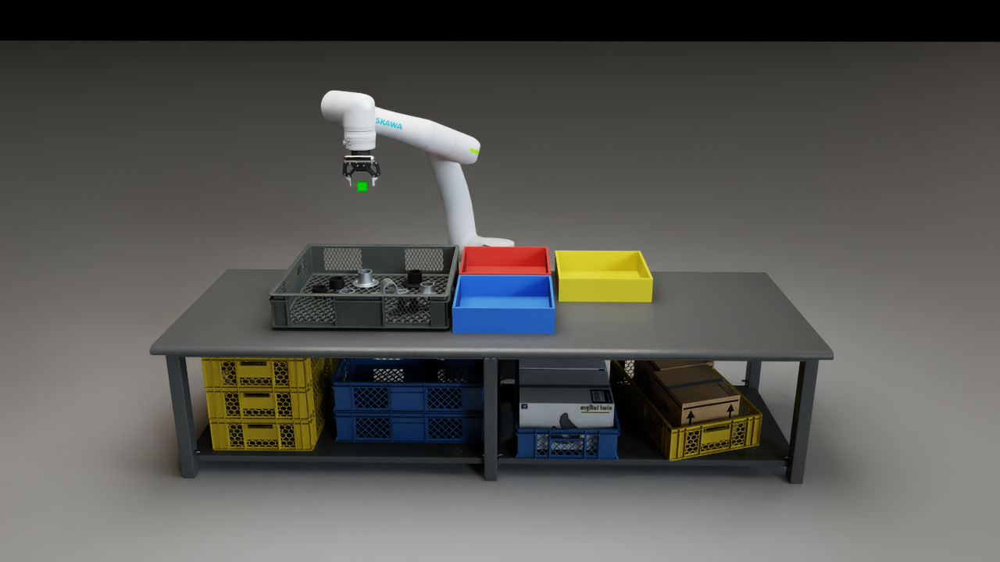</p>

## Environment

### Hardware and parts

| Item | Details |
|---|---|
| Arm | Yaskawa Motoman NEXT NHC12 (6 axes) |
| Gripper | Robotiq 2F-85 (85 mm max opening) |
| Camera | Intel RealSense D455 on the wrist; left image (640 × 480) and depth |
| Parts | Three pipe fittings, each in black or galvanized finish; 8 parts per basket |
| Bins | `flange_round` → red; `bracket_mid` → blue; `bracket_end` → yellow |

`flange_round` and `bracket_end` stand upright: a 60 mm tube on a base plate. `bracket_mid` lies flat, with a tube across its middle. The arm works only from what the wrist D455 sees.

### Software

| Item | Details |
|---|---|
| Simulator | NVIDIA Isaac Sim 6.0 (scene `scenes/lab_cell_g1.usda`) |
| Detection | YOLO26n-seg instance segmentation (Ultralytics), 3 classes, input 960 |
| YOLO runtime | A separate Python 3.12 environment (`perception/.venv`), running as a background server |

## Results

One full basket, sped up 3×: the front view of the cell, with the wrist D455 view in the top-right corner. Full-length video: [`outputs/demo/sort_demo.mp4`](outputs/demo/sort_demo.mp4).

<p align="center">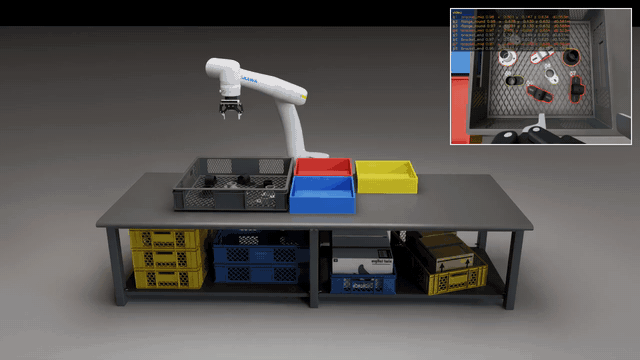</p>

## How it works

### 1. Detection: YOLO

The training data is entirely synthetic. Parts fall into a basket under physics, and a simulated D455 photographs the pile along random paths.

<p align="center">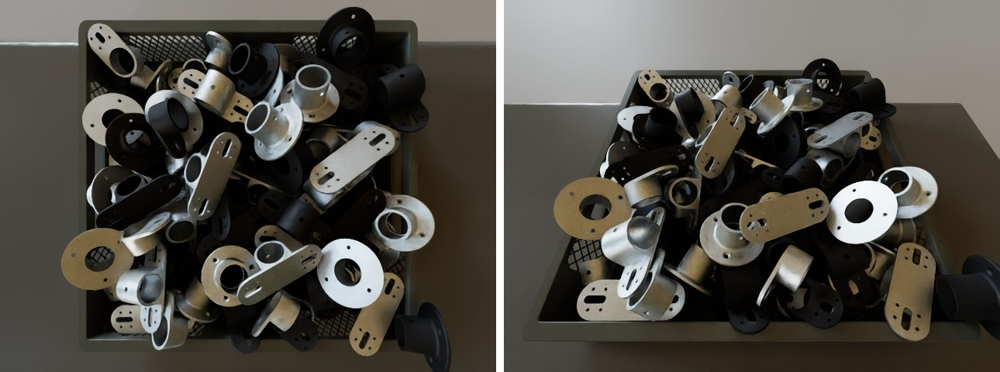</p>

Every capture run changes the basket, table, floor, lighting and part finish.

<p align="center">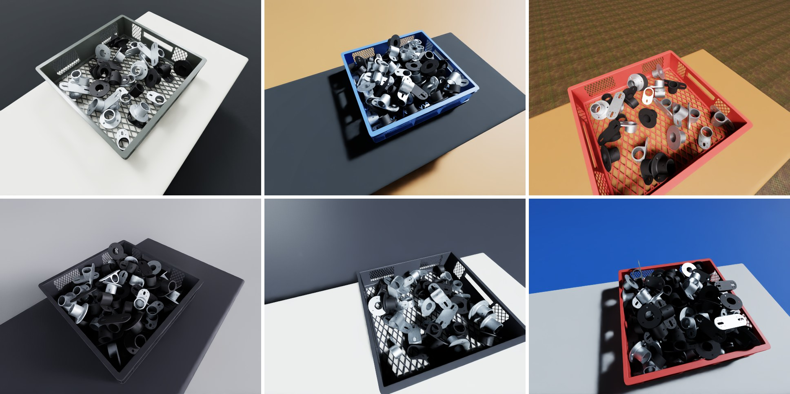</p>

Camera height, tilt and heading are spread over a range, and the lighting falls into bright, normal and dim.

<p align="center">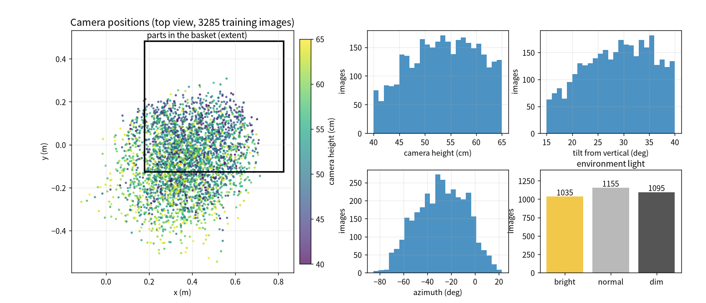</p>

The simulator also outputs a mask for every part, which serves as the label.

<p align="center">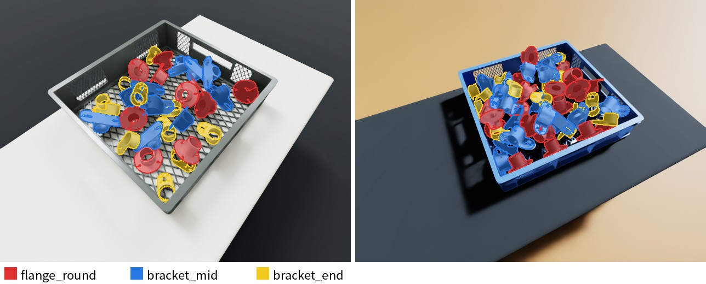</p>

| Split | Images | Purpose |
|---|---|---|
| Train | 3285 | Learning |
| Validation | 450 (30 baskets) | Comparing settings, choosing the model |
| Test | 300 (20 baskets) | Final score |

Validation and test use lighting and tables never seen in training, so the score reflects new surroundings. The model was first trained on parts lying on a flat table, then trained further on the 3285 pile images for 100 epochs at input size 960.

### 2. From point cloud to grasp

The depth camera turns each YOLO mask into a 3D point cloud in world coordinates. The arm stops high above the basket (view A), looks at the whole basket once, and decides from the points how to grip each part and where to put it.

<p align="center">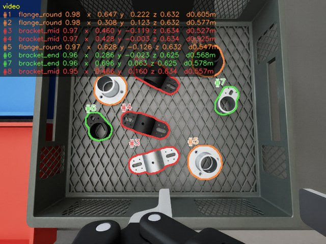</p>
<p align="center">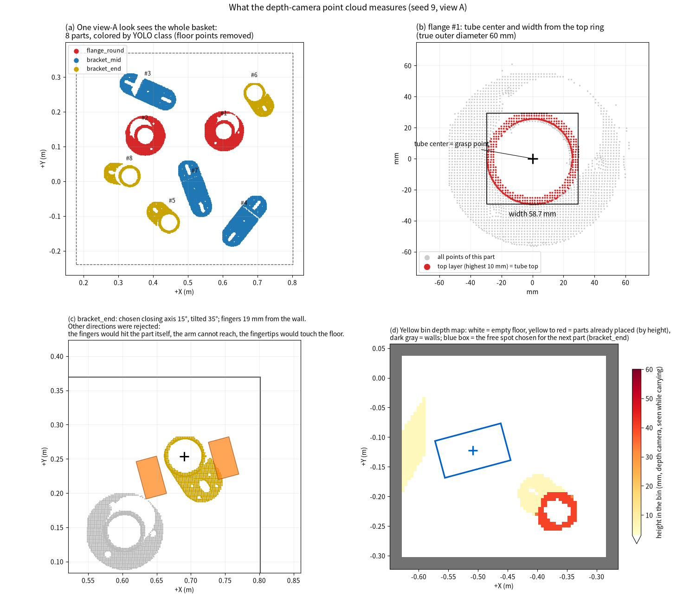</p>

Panels (a) to (d) follow the order in which the robot works, and every decision comes from the camera's points:

- **(a)** One look from view A gives each part's points and class.
- **(b)** For the part to pick, the top ring of points reveals the tube: its center is the grasp point and its width sets how far the gripper opens.
- **(c)** The robot tries every closing direction and keeps those where neither finger touches the part itself, a neighbor, the basket wall or the floor, and the arm can reach. It tilts the hand when needed.
- **(d)** While carrying, the same camera maps the target bin and picks a free spot large enough for the part and the open fingers.

### 3. Picking order

The order is fixed once at view A: all parts, regardless of type, nearest to the arm base first. A part that cannot be gripped yet moves to the end of the queue and is planned again when its turn comes. The arm then picks one part after another, places it in its bin and goes straight to the next. It returns to view A only when a grasp fails, a part slips during lifting, or the next part may have been disturbed.

### 4. Gripping the three parts

All three parts are gripped by their tube. `flange_round` and `bracket_end` are held at the upright tube; `bracket_mid` is preferably held from both sides of its tube. Each candidate direction must keep the fingers clear of neighbors, the basket wall and the floor, and among those the least tilted direction wins. The figure shows one real grasp of each part from above and from two sides.

<p align="center">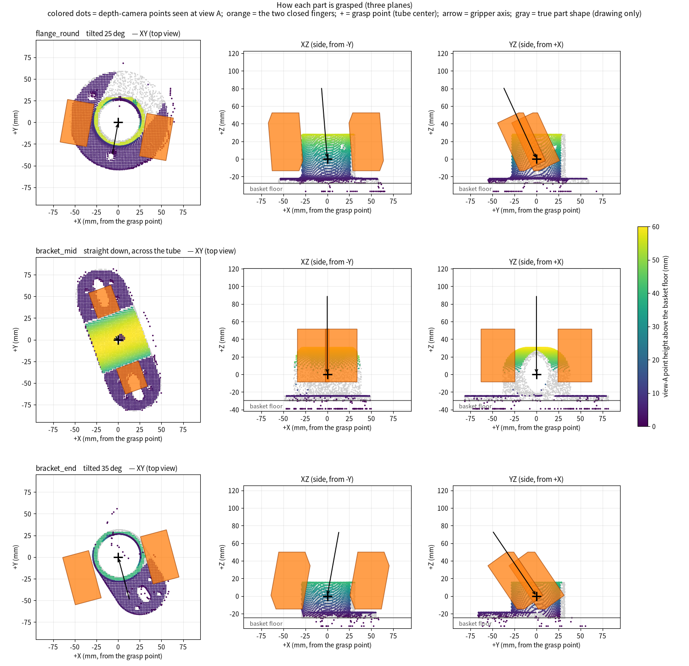</p>

### 5. Arm motion

The arm follows a target point with inverse kinematics, and the target moves along a smooth planned path with rounded corners. In most of the basket the gripper goes straight down. The farther a part lies and the closer it is to the far corner, the more the system tilts the gripper (up to about 40°), so the arm can still reach it and lift it to a safe carrying height.

<p align="center">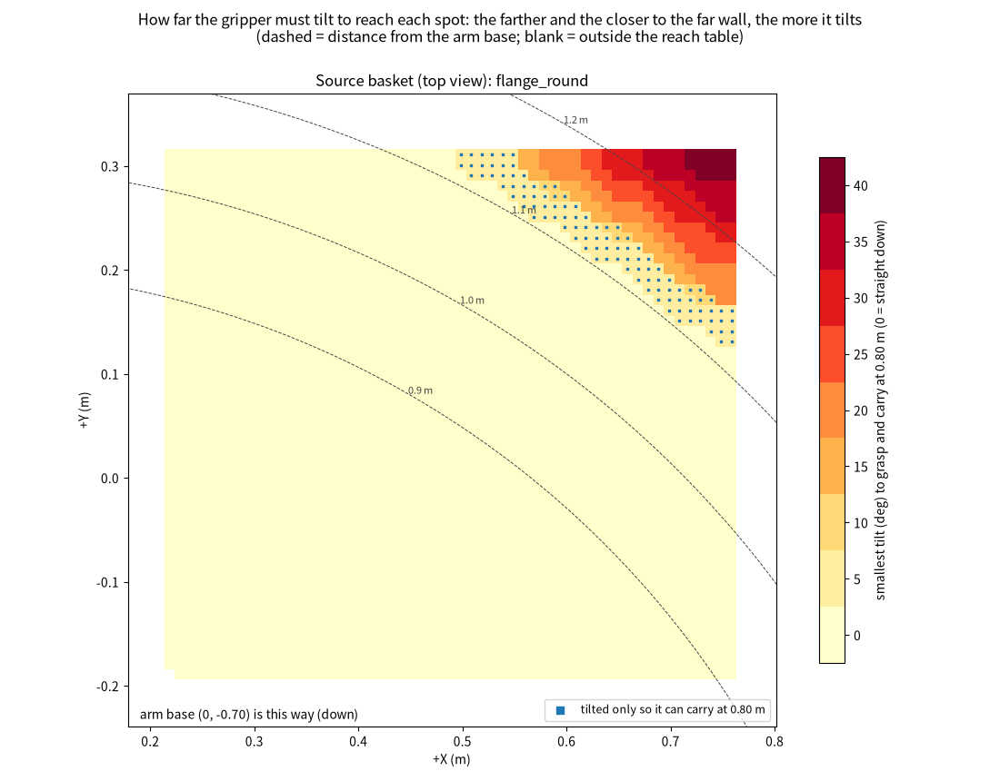</p>

Lifting and setting down are slow. The move from the basket to the bin follows a trapezoidal speed profile (1.2 m/s² acceleration, 1.0 m/s maximum); on short moves the arm starts slowing down before it reaches top speed.

<p align="center">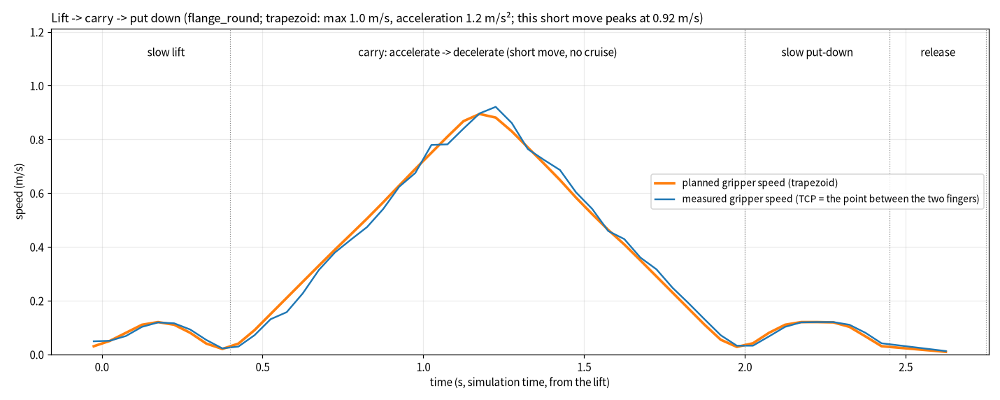</p>

## Usage

**One-time setup**

1. Create the Python environment for YOLO (requires `uv`):

   ```bash
   LOCK=requirements.basket.lock.txt bash perception/setup_yolo_env.sh
   ```

2. The scene's lighting files are read from `/mnt/data/Lin(sda)/About Yolo/assets/`. Make sure that disk is mounted.

**Steps**

1. Open `scenes/lab_cell_g1.usda` in Isaac Sim.
2. Paste this line into the Script Editor and run it, with the path changed to this folder. After about 10 s it prints `demo_start: READY`.

   ```python
   exec(open("/path/to/project-smart-picking-arm-2/demo_start.py").read())
   ```

3. Lay out the parts. The number selects the layout; the same number always gives the same layout.

   ```python
   layout(26, 8)
   ```

4. Start sorting. The call returns at once and the arm works in the background; the console prints the result when the basket is done. Wait for it before the next `layout()`.

   ```python
   sort()
   ```

| Command | Input | Output |
|---|---|---|
| `layout(seed, count=8)` | Layout number, number of parts | Parts placed in the basket; all three bins emptied |
| `sort()` | None | Parts sorted into their bins; result printed to the console and logged in `outputs/sort/<time>_s<seed>_n<count>/` |

The layout exists only in the running session. Do not save the scene.

## Flow

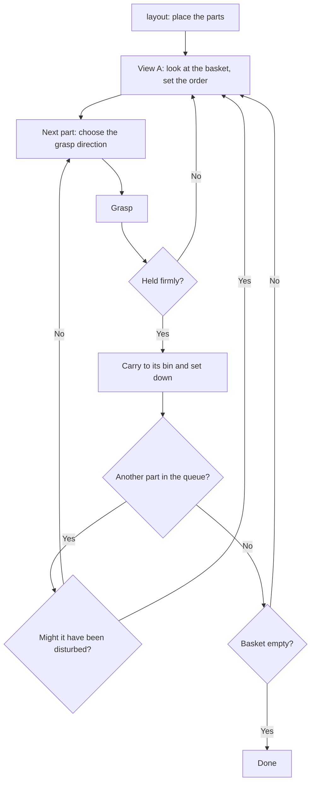

## Performance (simulation)

**Detection**: on the test set, when asked for a class, the most confident detection is the right part and its mask overlaps the true outline by at least 75%: `flange_round` 100%, `bracket_mid` 99.9%, `bracket_end` 100%.

<p align="center">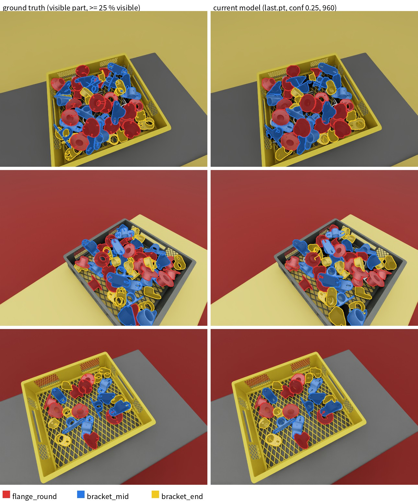</p>

**Sorting**: across 11 random layouts (including parts against the wall and in corners), all 88 parts went into the right bin, at about 9.5 s per part.

## Failure cases and countermeasures

| Situation | Countermeasure |
|---|---|
| Part slips while lifting | Put it back, grip a little tighter and try again; if it still slips, let go and look again from view A |
| Grasp fails | Look again from view A; a spot that fails twice is skipped |
| One part seen as two | After the empty grasp, look again from view A |
| Part against the wall or in a corner | Reach in with a tilted gripper and keep that angle while lifting and carrying |
| Two parts picked at once | Compare the gripped width; if it is too wide with a neighbor nearby, let go and retry |
| A move disturbs the next part | Look again from view A |

## Folders

| Path | Contents |
|---|---|
| `demo_start.py` | Entry point |
| `lab/` | Detection and tracking, grasp planning, arm motion, `layout()` and `sort()` |
| `perception/` | Camera and YOLO server, detection settings |
| `scripts/ik_controller.py` | Inverse-kinematics controller of the arm |
| `scenes/`, `assets/`, `parts/usd/` | Scene and assets |
| `yolo/` | Model and training records |
| `outputs/demo/` | Images and videos used on this page |
